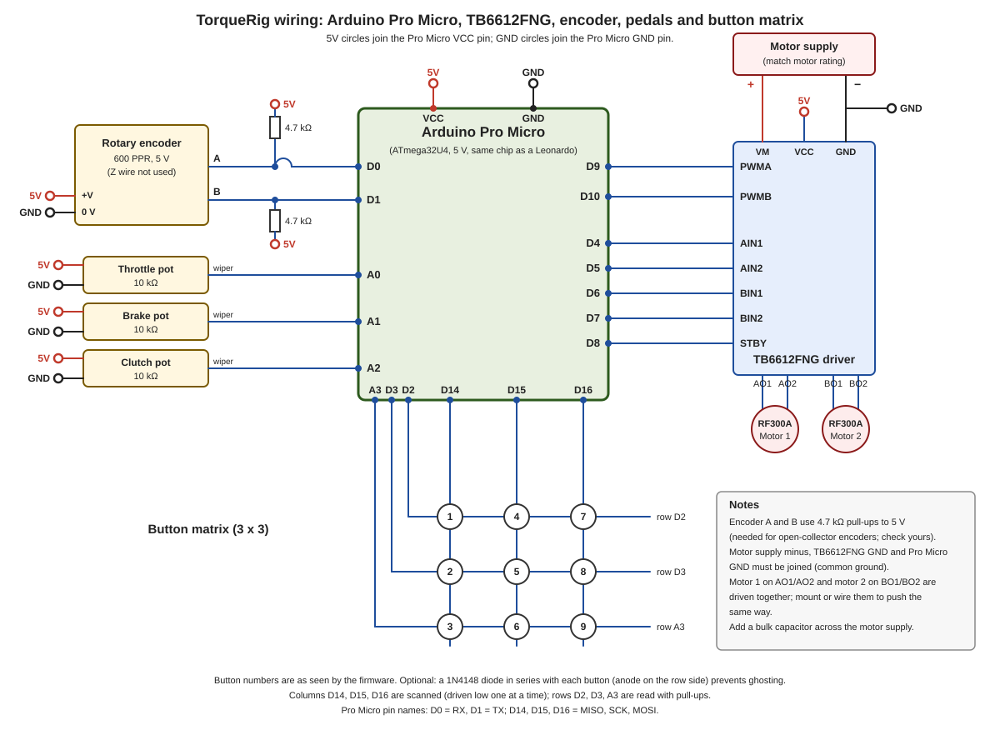

# TorqueRig

Arduino firmware for a DIY USB racing wheel with force feedback, running on an **Arduino Pro Micro**
(ATmega32U4). It shows up in Windows as a DirectInput game controller with FFB, a steering axis,
three pedals and a button matrix.

Derived from [AFFBWheel](https://github.com/vsulako/AFFBWheel) by Sulako (MIT). See `NOTICE.md`.

## Hardware

| Part | Used for |
|---|---|
| Arduino Pro Micro | Controller and USB interface |
| 2x RF300A DC motors | Force feedback |
| TB6612FNG | Motor driver |
| 600 PPR rotary encoder (ProRange) | Steering position |
| 3x 10 kOhm potentiometers | Accelerator, brake and clutch pedals |
| Tactile buttons in a matrix | Gear up/down, left/right indicators, 5 spare buttons |

The button matrix keeps the number of used pins low. Pin numbers and options are set in `config.h`.

Encoder setting: `ENCODER_PPR` in `config.h` is the number of counts per revolution after 4x quadrature
decoding, i.e. 4 x the encoder's PPR. A 600 PPR encoder therefore uses `2400` (the current value).

## Pin mapping



| Function | Pro Micro pin |
|---|---|
| Encoder A | D0 |
| Encoder B | D1 |
| TB6612FNG PWMA | D9 |
| TB6612FNG PWMB | D10 |
| TB6612FNG AIN1 | D4 |
| TB6612FNG AIN2 | D5 |
| TB6612FNG BIN1 | D6 |
| TB6612FNG BIN2 | D7 |
| TB6612FNG STBY | D8 |
| Matrix row 1 | D2 |
| Matrix row 2 | D3 |
| Matrix row 3 | A3 |
| Matrix column 1 | D14 |
| Matrix column 2 | D15 |
| Matrix column 3 | D16 |
| Throttle pedal | A0 |
| Brake pedal | A1 |
| Clutch pedal | A2 |

The motor pins are fixed in `motor.cpp`. The encoder, pedal and matrix pins are set in `config.h`.

### Button matrix

```
          Columns
          D14   D15   D16

 D2       B1    B2    B3
 D3       B4    B5    B6
 A3       B7    B8    B9
```

Each button connects one row line to one column line. The firmware drives the columns (D14, D15, D16) low one
at a time and reads the rows (D2, D3, A3) with internal pull-ups. In `config.h` these are named the other way
round (`BM_COL_PINS` = D2, D3, A3 and `BM_ROW_PINS` = D14, D15, D16). The wiring is the same either way.

The firmware numbers the buttons column by column, so the numbers you see in the GUI and in games differ
from the B1 to B9 labels above:

| Matrix label | B1 | B2 | B3 | B4 | B5 | B6 | B7 | B8 | B9 |
|---|---|---|---|---|---|---|---|---|---|
| Button number in firmware | 1 | 4 | 7 | 2 | 5 | 8 | 3 | 6 | 9 |

Optional: put a 1N4148 diode in series with each button, anode on the row side (D2, D3, A3), so that pressing
three or more buttons at once does not register extra "ghost" presses.

### Power and motors

- Each motor connects to one TB6612FNG channel: motor 1 to AO1/AO2, motor 2 to BO1/BO2.
- The firmware drives both channels with the same direction and PWM value, so mount the motors so they turn
  the wheel the same way, or swap the leads of one motor.
- Supply VM with a motor supply that matches the motors' rating and the driver's limits, tie its ground to the
  Pro Micro ground, and put a bulk capacitor across VM and GND. Power VCC from the Pro Micro's 5 V.
- The pedal potentiometers go between 5 V and GND, with the wiper to the analog pin.

### Pin conflicts to check in `config.h`

`config.h` still enables four auxiliary analog axes: `PIN_AUX1` (A3), `PIN_AUX2` (A8), `PIN_AUX3` (A6) and
`PIN_AUX4` (A7). On the Pro Micro, A3 is a matrix row, and A8, A6 and A7 are the same pins as D8, D4 and D6
(STBY, AIN1 and BIN1). Comment out those four `#define` lines unless you wire real axes to other free pins,
otherwise the controller reports extra axes that read these pins.

## Build and upload

1. Install Arduino IDE 1.8.19 (later versions may have errors with this code).
2. Install the libraries listed in `NOTICE.md`.
3. Open `TorqueRig.ino` (the folder name must stay `TorqueRig`, matching the .ino file).
4. Check `config.h` for your encoder resolution, motor driver pins, pedal pins and button matrix.
5. Select **Tools > Board > Arduino Leonardo** (or Pro Micro) and the correct port, then upload.

## Configuration tool

Settings (wheel range, FFB gains, axis limits, button mapping) can be changed with serial commands or
with the original [AFFBWheel GUI](https://github.com/vsulako/AFFBWHeelGUI). The firmware still
reports the handshake id `AFFBW` so that the GUI recognizes the device.
